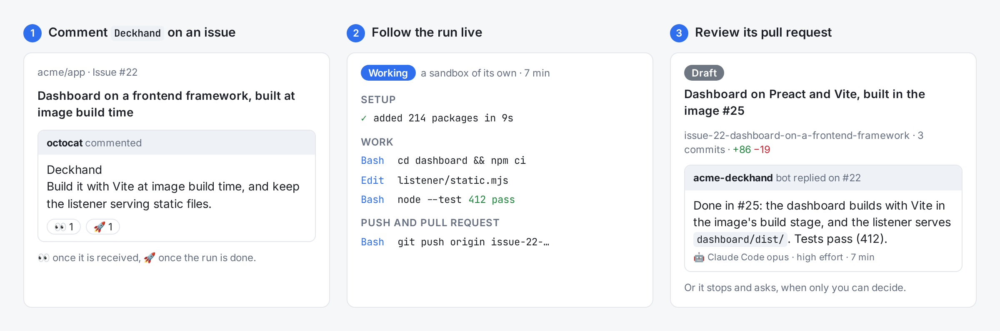
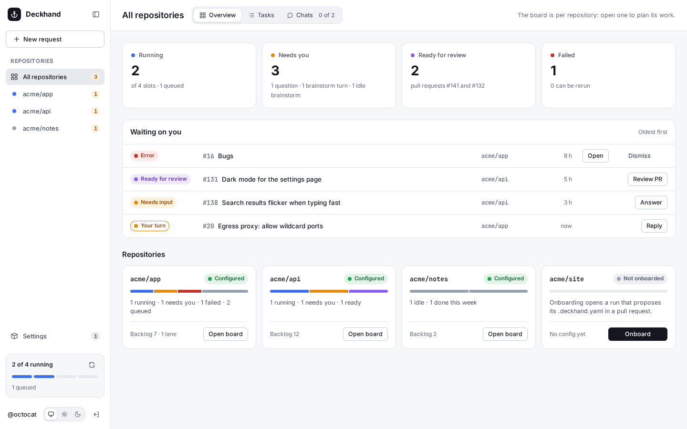

# Deckhand

Deckhand runs Claude Code on your GitHub issues and pull requests. Comment `Deckhand` on an
issue and it starts a sandbox, works on a branch, opens a draft pull request and answers on the
issue when it is done, or stops to ask when only you can decide.

It is self-hosted and bring-your-own-key: you create your own private GitHub App, run your own
server, and use your own Claude credential (or [Codex](docs/guides/codex.md), or the
[Antigravity CLI](docs/guides/antigravity.md)). One deployment serves one operator, across
as many repositories as the App is installed on.

<picture>
  <source media="(prefers-color-scheme: dark)" srcset="docs/images/hero-dark.png">
  
</picture>

- **Comment triggers**: `Deckhand` starts a run, and later comments continue its session;
  `/mode brainstorm` discusses without code, `/after #77` waits for another issue.
- **Needs input**: a decision only you can make becomes numbered questions on the issue, and
  your answer continues the run.
- **A sandbox per issue**: no GitHub token, no host paths, and a network that reaches only the
  hosts you grant. Every write goes through a gateway and your policies.
- **Reviews, inboxes, onboarding, your own machines, and a dashboard** with every run's live
  log.

The dashboard follows every task and run, across your repositories ([the dashboard](docs/guides/dashboard.md)):

<picture>
  <source media="(prefers-color-scheme: dark)" srcset="docs/images/dashboard-overview-desktop-dark.png">
  
</picture>

**Documentation: [bryansmee.github.io/deckhand](https://bryansmee.github.io/deckhand/)**, from
[`docs/`](docs/).

## Quick start

You need a server with Docker Engine 26 or later and the compose plugin, an HTTPS address
GitHub can reach forwarding to port 8080, and a Claude credential (a token from
`claude setup-token`, or an `ANTHROPIC_API_KEY`).

```sh
git clone https://github.com/BryanSmee/deckhand.git
cd deckhand
cp .env.example .env              # CLAUDE_CODE_OAUTH_TOKEN or ANTHROPIC_API_KEY
cp -r server.example server       # your GitHub login in server/config.yaml's allowed_users
docker compose pull
docker compose up -d
docker compose logs edge          # prints a one-time …/setup?token=… link
```

Open the setup link through your public address, create the GitHub App and install it on a
repository. Then comment `Deckhand` on one of its issues.

To update, run `docker compose pull` and `docker compose up -d` again. Watchtower alone isn't
enough: it doesn't pull the sandbox image, which then lags the services
([Updating](docs/guides/updating.md)).

The [quick start](docs/get-started/quick-start.md) walks through each step;
the [guides](docs/guides/install.md) go further, [Server settings](docs/reference/settings.md) has every
setting and [Comment commands](docs/reference/comment-commands.md) every command, and the [security model](docs/security.md) what to read before you install it on a
repository other people write to. To report a vulnerability privately, see [SECURITY.md](SECURITY.md).

## Claude Code and naming

Deckhand runs Claude Code; it is not made by or affiliated with Anthropic, and Claude Code is
not bundled in any image: it installs on first start, at a pinned version. Each operator uses
their own Claude credential, under their own agreement with Anthropic, and follows Anthropic's
[Usage Policy](https://www.anthropic.com/legal/aup).

## Contributing

See [CONTRIBUTING.md](CONTRIBUTING.md) for how issues and pull requests are handled,
[AGENTS.md](AGENTS.md) for the commands, conventions and security rules, and
[Architecture](docs/contributing/architecture.md) for how the services work together.

## Licence

[Apache License 2.0](LICENSE).
