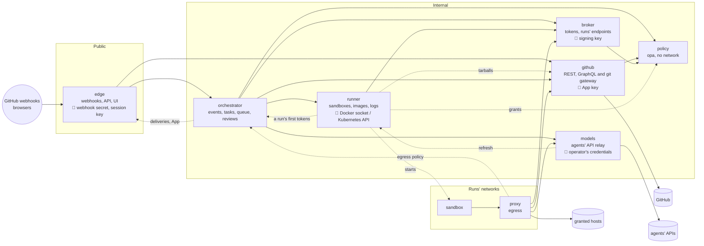

# Services

Deckhand runs as services (#499, its parts #500 to #509): edge and the orchestrator (#506,
[Edge and the orchestrator](upgrades.md#edge-and-the-orchestrator)), beside the policy service
(#501, [each-service.md](each-service.md#the-policy-service)), the broker (#505,
[each-service.md](each-service.md#the-broker-service)), the runner (#503,
[each-service.md](each-service.md#the-runner-service)), the github service (#502,
[each-service.md](each-service.md#the-github-service)), the models service (#504,
[each-service.md](each-service.md#the-models-service)) and the egress proxy, each from its own
image: [architecture.md](architecture.md) describes what each module does.

The split follows who holds which secret and who can reach what. The only service the internet
reaches holds neither the App's key, the operator's agent credentials nor the Docker socket, and
each secret lives in one service.



| Service      | Holds                                                                           | Owns (its own store)                               | Reached by                                                                                                                                                             |
| ------------ | ------------------------------------------------------------------------------- | -------------------------------------------------- | ---------------------------------------------------------------------------------------------------------------------------------------------------------------------- |
| edge         | webhook secret, session key, OAuth client                                       | sessions, deliveries taken, their stream           | the internet, browsers, orchestrator (the deliveries' stream, the App's public parts, the dashboard's tags)                                                            |
| orchestrator | nothing secret                                                                  | queue, waits, tasks, history, decisions, its lease | edge (the dashboard's API), runner (a run's first tokens, once its sandbox's network exists), proxy (the egress policy)                                                |
| runner       | Docker socket or Kubernetes API; blob storage's key pair (`BLOB_URL`), when set | containers, networks, run logs                     | orchestrator (and the egress policy, which stays with it), models (the plan logins' refresh only)                                                                      |
| broker       | the tokens' signing key; blob storage's key pair (`BLOB_URL`), when set         | live runs, run files                               | orchestrator (a run's first tokens, for the runner), runner (the runs' inboxes and files), proxy (sandboxes), every service that calls another (its own service token) |
| github       | the App's key, installation tokens                                              | each run's issues, reactions, pushes               | edge, orchestrator, proxy, runner (the repo's tarball, for build contexts)                                                                                             |
| models       | the operator's agent credentials                                                | plan logins (sealed), runs' API state              | proxy (the agents' calls), orchestrator (which credentials it holds, their fingerprints, a run's API state, its stream)                                                |
| policy       | nothing secret                                                                  | nothing (reads the policy folders)                 | github, orchestrator, broker, runner (the operator's grants for a repository)                                                                                          |
| proxy        | Deckhand's CA                                                                   | the egress cache                                   | sandboxes                                                                                                                                                              |

The broker also serves the endpoints a sandbox calls about its own run: its token's renewal, its
inbox and files (`broker/`, #505). A run's progress and its questions still come from its log, which
the runner follows: nothing for a sandbox to call yet. The egress policy is the orchestrator's: it
answers by the address a connection comes from, which it asks the runner, and gives the proxy the
network it vouches for to the broker. A run's first tokens are the orchestrator's to have the broker
sign, with the claims it decided: the runner asks it for them once the sandbox's network (or pod)
exists, and never chooses what they allow. Every service that calls another also calls it for its
own service token (#500), which the diagram leaves out; the policy service calls none, and checks
the tokens it gets offline. The dotted arrows are narrow: the runner fetches a repository's tarball
from the github service for build contexts (the App's key stays there), models has the runner start
the plan logins' refresh, and the runner copies each run's inbox and files to the broker as they
change (`listener/runner/inbox.mjs` `mirror`), and the runner asks the policy service what the
operator's policies [grant](../reference/server-folder.md#the-grants) a repository (`GET /policies`,
`POST /evaluate`, the operator's layer only), to check every sandbox spec and image build against it
again. A run's live log reaches the dashboard through the orchestrator, which reads it from the
runner and answers what edge passes on: edge calls the runner for nothing.

## Health

Every service answers `GET /health` without a token, for its probes and the dashboard's status
page (#560), with the same JSON (`lib/health.mjs`):

```json
{ "ok": true, "startedAt": 1791990000000, "version": "1.4.0" }
```

`startedAt`: when it started, in ms; `version`: the release its image was built from
(`DECKHAND_VERSION`, `dev` from source). The github service adds `app` (whether it holds an App) and
the runner `active` (whether this copy holds its lease), as before; nothing else, ever: the answer
needs no token. Edge answers it on its internal port (its public `/health` stays a plain `ok`), the
egress proxy beside `/ready`, the policy service in JSON now (its status unchanged). `/ready` is the
readiness probe's (the orchestrator's says, beside `ok`, how many items of its state wait for the
store, `waiting`, and how many runs' ends, `ending`: #821, still `200`): `503` once a service
drains, or on a copy waiting for its lease, and on edge, the github and models services and the
egress proxy until the broker has answered them (edge and the github and models services its keys
and their service tokens, the proxy its service tokens; edge's on its public port, a plain `ready`,
as its `/health`): a new pod's calls may not get out for a few seconds after it starts (k3s's
kube-router applies its NetworkPolicies then), and the calls it took meanwhile would fail (#391).

The orchestrator asks each one it has a URL for, at most every 10 s, and the dashboard shows
what it found in Settings › Server: the diagram above, each service green (`up`), blue
(`starting`: started less than 5 minutes ago) or red (`down`: no answer within 2 s, a refused
connection, a status other than 2xx, `ok: false`), with its state in words; the outside parts
and the sandboxes grey, unchecked. A dot by Deckhand's name says when one is down (red) or
starting (blue). Edge reaches none of them but the orchestrator, the github service and the
broker, so the checks are the orchestrator's ([queue.md](queue.md#around-the-runs)).

## What limits a leaked token

- **Run tokens** (#493): **where**, the services are reachable from the runs' networks only
  through the proxy, so a token leaked to the internet opens nothing; **who**, it is bound to
  its sandbox's network, which the proxy vouches for, so another sandbox can't replay it; **how
  long**, valid for 15 minutes, then renewable only from its own sandbox, by the one the
  sandbox holds, within a 7-day grace (`RENEW_GRACE_MS`, so a broker away for a while doesn't
  end the run), and nothing once its network is removed. The agent's own token,
  which its CLI reads once at start and can't renew, lasts the run instead (7 days at most), bound
  the same way and for the agents' endpoints alone ([Run tokens](../security/tokens.md#run-tokens)).
- **Service tokens** (#500, [Service tokens](../security/tokens.md#service-tokens)): signed by the broker, with `sub` (the
  caller) and `aud` (the service called), 15 minutes, and bound to the caller: its pod's service
  account on Kubernetes, the network a call arrives on with Docker (one network per caller and
  callee).
- **What each caller may do**: each service accepts from each caller only what it needs, in
  one table per service. The github service lets edge read, never mint a token or write: a
  compromised edge, already inside the internal network, gets no more.
- **The network has to be closed**: with Docker, only the proxy sits on the runs' networks (a test
  reads `compose.yaml`); on Kubernetes, NetworkPolicies need a network plugin that enforces them,
  which the runner checks with a probe pod before it starts any run
  ([The network probe](../kubernetes/isolation.md#the-network-probe),
  `deploy/kubernetes/check-isolation.sh`).

## Rules

- **No shared database**: each service keeps its own state through one store interface
  (`lib/store.mjs`: keys with TTLs, atomic operations, leases with a fencing epoch, acknowledged
  streams, blobs; its file backend for one node, `lib/store-file.mjs`, #500; Redis on several,
  `lib/store-redis.mjs`, #509: [The store](../guides/store.md)), and
  passes its changes to those that need them as store streams, acknowledged once handled, so a
  handover loses none. The broker streams run starts, ends and progress; edge, verified events; the
  orchestrator, task updates for the dashboard; the runner, run events (started, ended, exit code;
  logs go to the store's blobs); models, the agents' calls it refused each run, for its log.
- **Secrets never go in the store** but encrypted by their own service, with a key only it
  holds: the plan logins the models service refreshes, for example (#504). The App's key, the
  signing key and the agents' credentials stay in their service's own secret or volume, never in
  the store (#509). With Redis on several nodes, every service that uses the store could read
  them otherwise.
- **Shared code** in `lib/`, copied into each image: no npm package in it, so "no runtime
  dependencies" holds per service. The github service keeps Deckhand's one exception,
  graphql-js, bundled at build (`listener/vendor/`).
- **Sandboxes outlive an update**: an endpoint that moves to another service first answers, for a
  while, with where to go instead (`docs/contributing/restarts.md`, Restarts).
- **The security rules of `AGENTS.md` hold per service.**
- **The UI** stays in edge: static files from the dashboard's build, on the same origin as its
  API.
