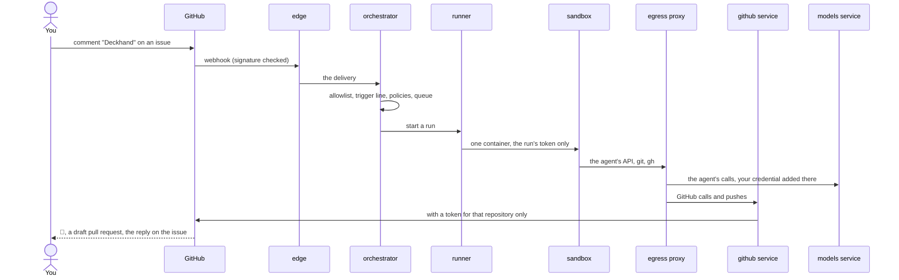

# Core ideas

A few words come back on every page of these docs. This is what they mean.

## Runs

A **run** is one agent session working on one issue or pull request, from the comment that
starts it to the reply it posts. Each issue has its own sandbox, branch (`issue-<n>-<slug>`)
and session: the next comment on it continues the same conversation, and a comment that arrives
while a run works reaches it as it goes. Runs wait in a queue when the server's parallel runs
(`max_parallel`) are all busy. A run ends with a reply, a question for you (`needs-input`), or an
error ([From a comment to a reply](../architecture.md#from-a-comment-to-a-reply)).

## Modes

A run is in a **mode**, which decides what it is for: **work** (implement, the default),
**brainstorm** (discuss without code), **onboarding** (propose a `.deckhand.yaml`),
**review** (a pull request's), **research** (the open web, without the code), or one the
repository declares in its `.deckhand.yaml`. A `/mode <name>` line picks one. A mode says what
the run is told and which volumes it gets, never what it may do: that is the policies'
([Modes](../repo-config/modes.md#modes)).

## The server folder and the grants

As the **operator**, you configure everything in one folder, `server/`, kept in git beside your
deployment, except the secrets, which stay in `.env`:

- `server/config.yaml`: your settings, `allowed_users` first.
- `server/grants/`: what you grant each repository beyond a bare sandbox: hosts its sandboxes
  may reach, host paths to mount, limits, and in `grants/policy/` the yes-or-no grants (its own
  Dockerfile, a container engine, workflows, auto-merge).

A repository's `.deckhand.yaml`, read from its default branch only, can narrow what you allow
(fewer users, fewer parallel runs) and ask for what you granted, never more
([The server folder](../reference/server-folder.md),
[The grants folder](../security/policies.md#the-grants-folder)).

## Sandboxes

A **sandbox** is the container a run works in: the base image, or the repository's own image
built `FROM` it. It runs the agent without permission prompts, in a clone of the repository
kept between the issue's runs. Deckhand assumes whatever runs there may misbehave, and limits
what it can reach:

- **No GitHub token.** Its GitHub calls carry a token that dies with the run, swapped by
  Deckhand's GitHub gateway for one limited to that repository, and its writes are checked by
  the policies. It can never push the default branch.
- **A closed network.** Its only way out is the egress proxy: the agent's API, GitHub, and the
  hosts you grant.
- **No host paths** unless you grant them, no privileges, and CPU, memory and process limits.

([Security model](../security.md), [Capabilities](../security/policies.md#capabilities).)

## Services

Deckhand runs as a few services, split by the secret each one holds, so that a hole in one
doesn't give away the others:

A comment's way through them, to the reply:

| Service        | What it does                                                                      |
| -------------- | --------------------------------------------------------------------------------- |
| edge           | The only one the internet reaches: webhooks, sign-in, the dashboard's files.      |
| orchestrator   | The queue and the runs' lives. It holds no secret.                                |
| github         | The only one holding the GitHub App's key: GitHub calls, the gateways.            |
| runner         | The only one with the Docker socket (or the Kubernetes API): starts sandboxes.    |
| models         | The only one holding your agents' credentials: the sandboxes' API calls go there. |
| broker         | Signs the runs' tokens, and answers what a sandbox asks about its own run.        |
| policy service | Evaluates your policies and the repositories'.                                    |
| egress proxy   | The sandboxes' only way out.                                                      |

([Services](../services.md), [Architecture](../architecture.md).)
