# The dashboard

The dashboard follows every task and run across your repositories, and starts, queues and stops
them. This page goes through its views, for when you first open it or look for one of its
controls. An MCP client reads the same as you do: see [MCP clients](mcp-clients.md).

## Signing in

Open edge's public address (`/`) and sign in with GitHub: the App's sign-in
(user-to-server OAuth) tells edge who you are, and only `ALLOWED_USERS` get in; anyone
else sees who they are signed in as and a refusal. The token GitHub returns is only used to
read your login, then revoked; the session is a signed cookie valid for 7 days, checked
against `ALLOWED_USERS` on every request (the key is `/data/session.key` in the `edge-data`
volume). Signing out ends all your sessions, in every browser, on both of edge's copies. Edge
serves the dashboard's files and passes its API on to the orchestrator, which answers it, with
your login. Each user sees and does what their access gives them, every action on every
repository by default, a repository's own `users` narrowing it
([Upgrading: access control](upgrade-notes.md#upgrading-access-control-725) to narrow it, and the
[Security model](../security.md#access)): the controls they may not use aren't shown, a repository
where they have no action not at all. **Settings › Access** (with `server:read`) shows each of
`ALLOWED_USERS`' actions, server-wide and on each repository, with the files that gave or
denied them. `/status` also answers calls
from inside edge's container (`docker compose exec edge …`) without a session, but not
those a reverse proxy forwarded.

Apps created by `/setup` before the dashboard had sign-in have no callback URL: on the App's
page on GitHub (Settings → Developer settings → GitHub Apps → your App → General), add
`<public URL>/auth/callback` under **Callback URL** and save.

## The Overview

The dashboard opens on the **Overview** (`#/`): how many runs are going (of the run slots, and
the queue), how many tasks wait on you, how many pull requests are ready for review and how
many runs failed, each a link to the tasks under that chip; then what waits on you across
repositories, oldest first, each with its one action (Answer its questions, Reply to a
brainstorm, Review the pull request, Rerun what failed); and a card per repository, with its
config's status, its tasks by state, its backlog and lanes, and its board (or Onboard for a
repository that isn't onboarded yet). Its **Tasks** view (`#/tasks`) lists every repository's
tasks.

|                                               | Light                                                                                                                                      | Dark                                                                                                                                     |
| --------------------------------------------- | ------------------------------------------------------------------------------------------------------------------------------------------ | ---------------------------------------------------------------------------------------------------------------------------------------- |
| The Overview                                  | 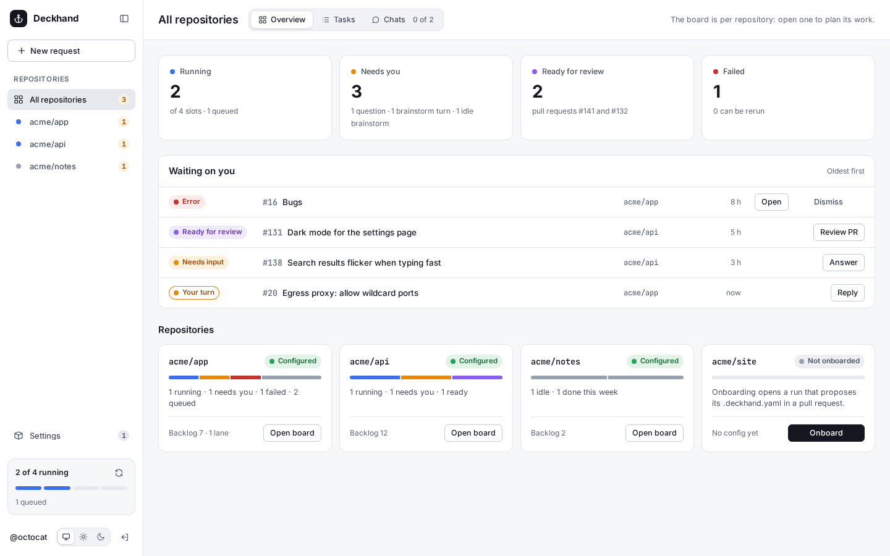                                     | 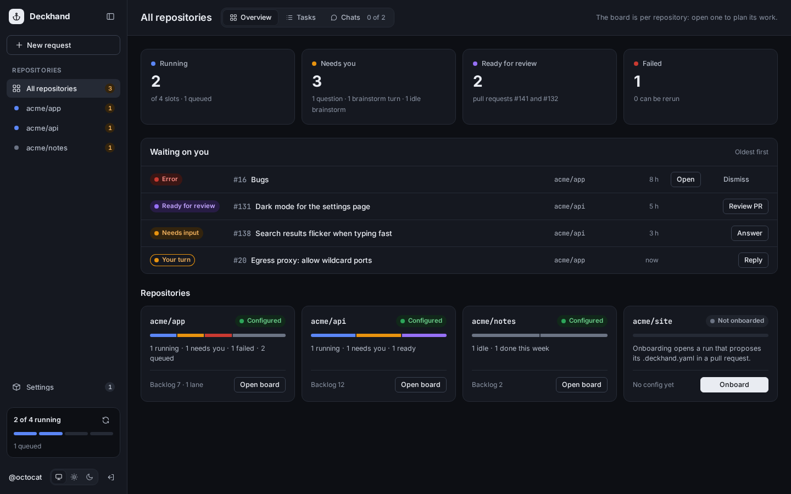                                     |
| A live run's log                              | 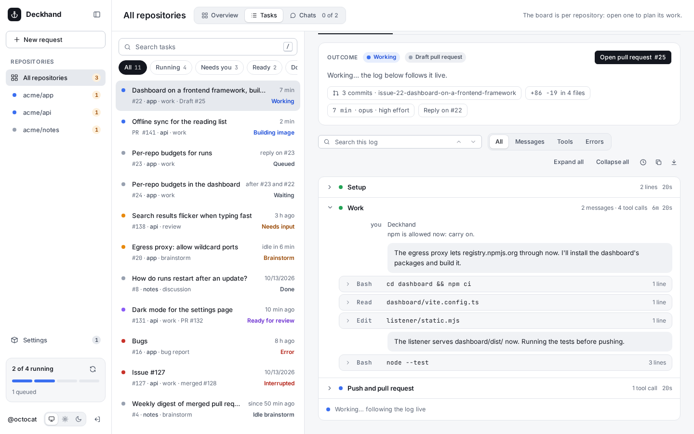                                  | 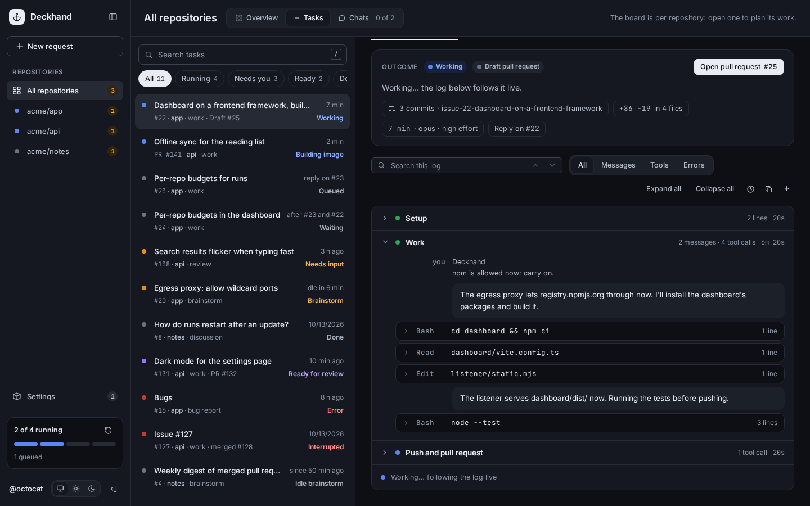                                  |
| A repository's config                         | 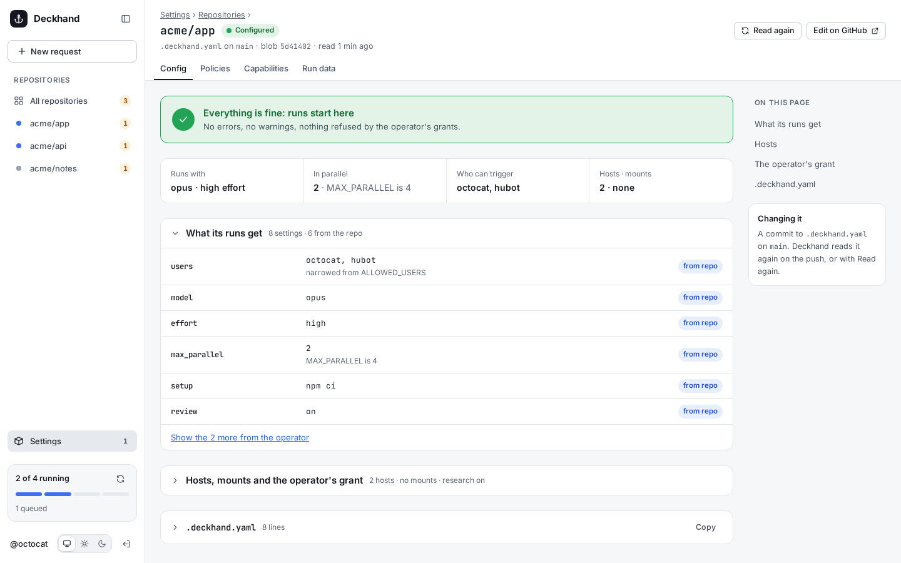                              | 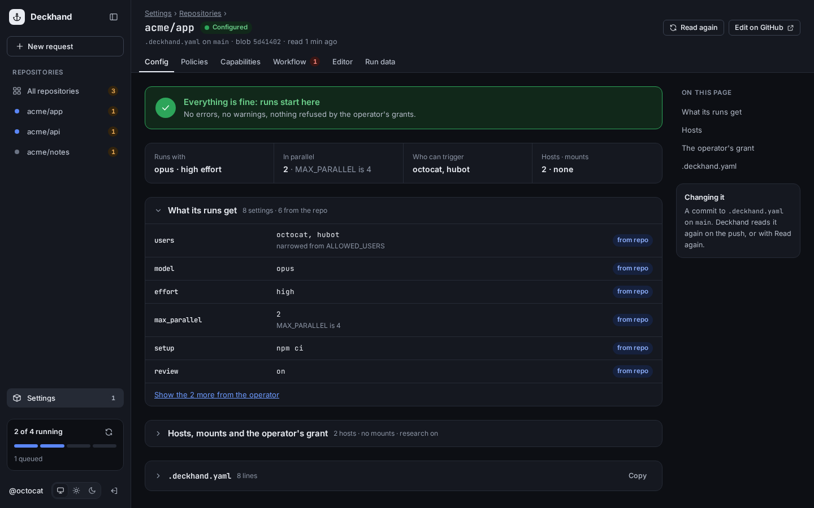                              |
| New request: an idea for a repository's inbox | 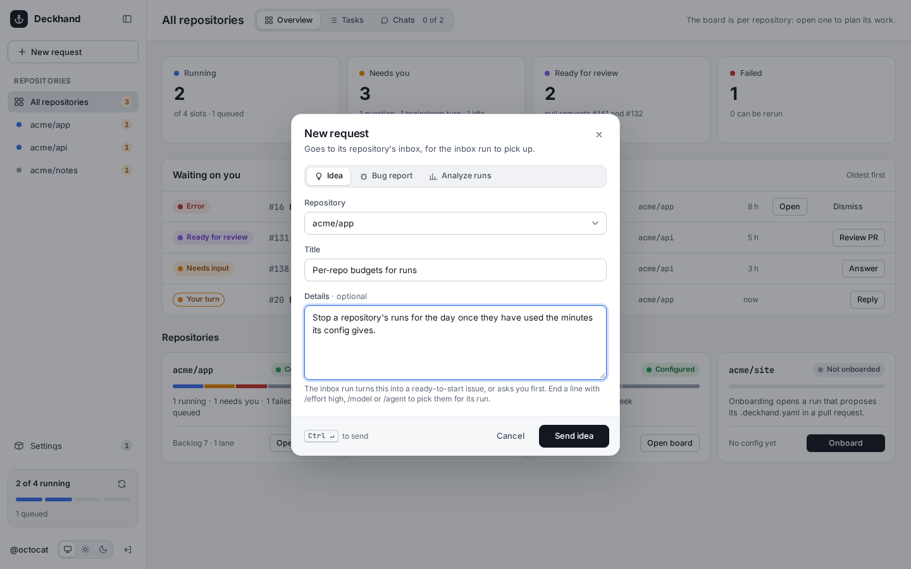 | 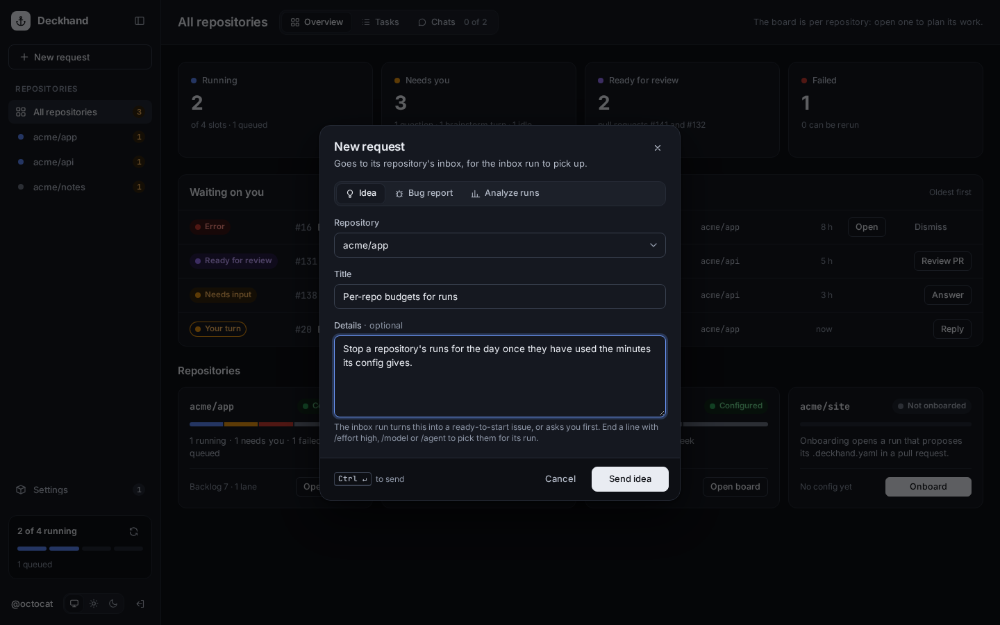 |

On a phone, a tab bar replaces the sidebar (the Overview and a run's log, then a repository's
config and New request, in each theme):

| Overview                                                                                                          |                                                                                                                 | Run log                                                                                                              |                                                                                                                    |
| ----------------------------------------------------------------------------------------------------------------- | --------------------------------------------------------------------------------------------------------------- | -------------------------------------------------------------------------------------------------------------------- | ------------------------------------------------------------------------------------------------------------------ |
| 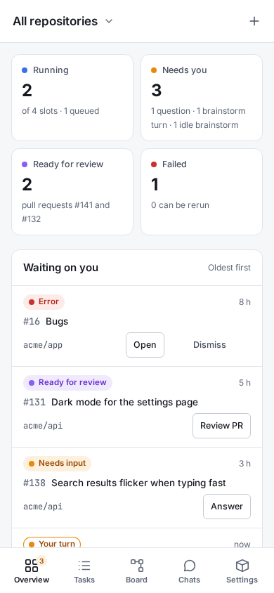 | 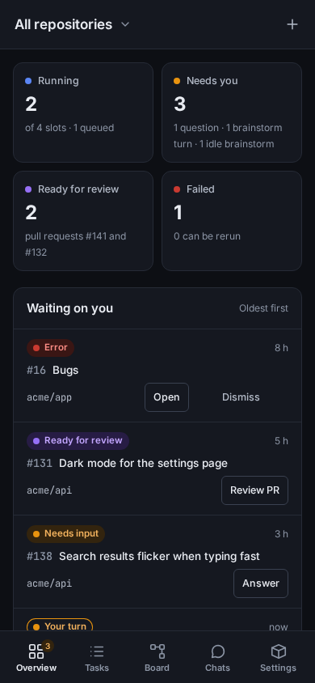 | 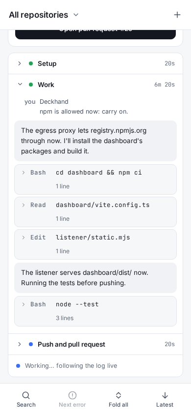 | 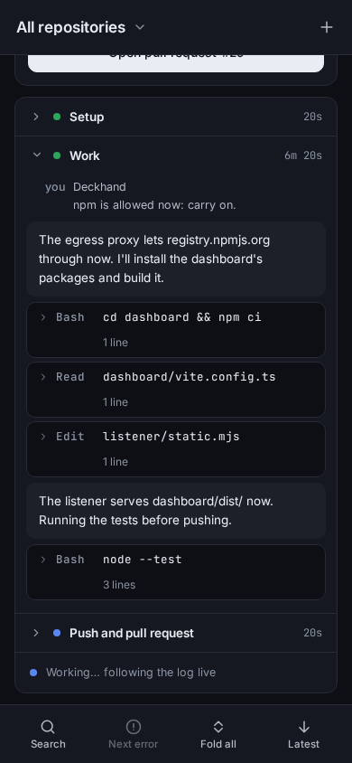 |

| Config                                                                                                                   |                                                                                                                        | New request                                                                                                                                           |                                                                                                                                                     |
| ------------------------------------------------------------------------------------------------------------------------ | ---------------------------------------------------------------------------------------------------------------------- | ----------------------------------------------------------------------------------------------------------------------------------------------------- | --------------------------------------------------------------------------------------------------------------------------------------------------- |
| 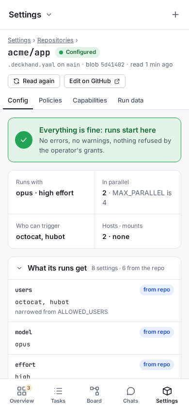 | 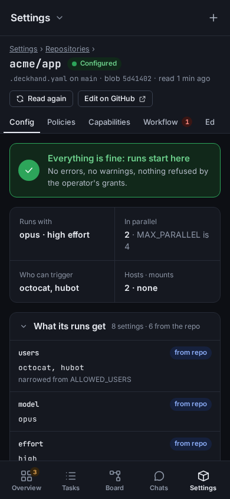 | 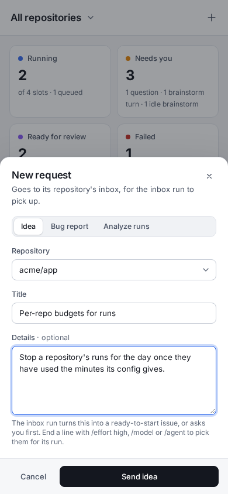 | 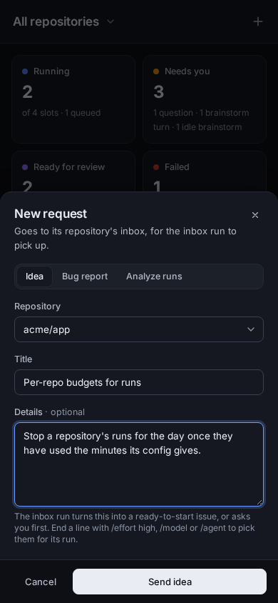 |

These pictures show made-up data (`acme/*`, `octocat`): `cd dashboard && npm run screenshots`
takes them again, against the dashboard's dev server with a fake API (`dashboard/src/shots.ts`).

## Tasks

The dashboard lists every issue, pull request and discussion Deckhand worked on, by title,
with a tab per repository (the most recently active first; each counts its running tasks and
those waiting for you) and chips by state: running (queued and `/after` waits too, and a pull request in review: between the runs of
its review-and-fix loop, `review.fix`), needs input (a brainstorm waiting for your
comment too), ready for review (once that loop is over; a loop that left blocking findings says
how many), done, error. Titles come with the webhooks; for tasks from before the dashboard
had them, the orchestrator asks GitHub once and keeps them in its [store](store.md).

Each task also links to its pull request (the one that closes its issue, or the pull request
itself), with a badge for its state: draft, ready for review, merged or closed, and an icon
for what CI says of its latest commit: running, failed (a red cross) or passed (a green check),
over its GitHub Actions runs, other services' check runs and commit statuses. Its title lists
them; in the task's header and the Overview's **Ready for review** rows it links to the failed
run, else the pull request's Checks tab. The
`pull_request` webhooks keep it current, in the orchestrator's store, and so do the changes Deckhand
lets through for runs (a run's `gh pr ready`); for tasks from before, the orchestrator looks through each
repository's 100 most recently updated pull requests once per start, and asks again about the
open ones at each start, so one that changed while it was down shows its current state. The
**Ready for review** chip lists the pull requests waiting for you, and the tab's title counts
them ("(2) Deckhand"). **Notify me when ready** (in the sidebar), or **Settings › Preferences**,
asks your browser for notifications: while a dashboard tab is open, a pull request that turns
ready for review raises one, and so do a run that needs your answers and, once turned on
there, a run that failed; each opens its task when clicked. Preferences also keeps the
theme, density, motion, start page, board and run log choices and the keyboard shortcuts, in
this browser only.

GitHub doesn't retry a webhook it couldn't deliver (edge down or restarting, a
reverse proxy or tunnel timing out, an outage on GitHub's side). Edge reads the App's
**Recent Deliveries** itself at start and every 5 minutes (one of its copies, the one holding
the store's lease `edge/redeliveries`), and asks GitHub to redeliver each
one that failed, once, within GitHub's 3 days: a comment posted meanwhile still gets its run,
whatever its age. The App needs no extra permission or event for that: an App can always read
its own deliveries. **Sync** (in the top bar, after the running and queued counts) does it
now, asks GitHub about the open pull requests' states again, and checks them for conflicts
in the repos that opted in (`conflicts.check_minutes`, see repo-config/issues.md), starting a rebase
run for each one in conflict: for when GitHub is unstable, or you just merged into a base
branch, and you'd rather not wait.

## The board

**Board** (Tasks | Board in a repository's header, `#/<owner>/<repo>/board`; the old
`#/graph` addresses lead there) draws the repository's tasks as a graph: an arrow goes from an
issue to each one waiting for it (`/after`), left to right, and the issues a task waits for
show even when Deckhand never worked on them. Issues with no arrow stand in a column below.
Each node says its number, its state and its title, in its state's colour (the legend floats on
the canvas): a border when it needs looking at (running, needs you, ready for review, error;
dashed red arrows: what waits for an error keeps waiting), dimmed once done (implemented: the
issue closed as completed, or its pull request merged). Whether an issue is closed comes with
the `issues` and `pull_request` webhooks; the rest is asked of GitHub with its title, kept in
the orchestrator's store, and what was open is asked again once per start. A node opens its task; one
Deckhand never worked on opens on GitHub. The toolbar zooms the graph and fits it to the
screen. **Lanes** shows each chain as a row instead (top to bottom on a phone, where it is the
default), named after its parent issue, its inbox, or the name you give it with its pencil
button; others are "#18 and 3 more". Your browser keeps the choice. The board has no
All-repositories view: All has the Overview instead.

By default the board leaves closed issues out: implemented and closed as not planned, with
their arrows, so what still needs something stays on top. An issue whose only blocker is hidden
stands in the column. A closed issue stays while an issue that waited for it is running. **Show
closed** brings them back; your browser keeps the choice. Runs on the ideas and bugs inboxes and
discussions are never drawn: they have no pull request and no `/after`. Only the issues drawn
can be queued after.

Beside the graph, the **work queue** (a sheet at the bottom on a phone) has five tabs.
**Backlog** lists the open issues with nothing live (running, queued, waiting, brainstorming or
needing input): drop one on the graph to start it (in the mode picked in **Start in**, in the
page's header), on a node to queue it after that one; one with sub-issues brings them along.
Above the list, a text field narrows it by number and title, **Labels** to the issues with any
of the labels ticked (or with none, **No label**), and **Hide sub-issues** leaves out those
whose parent is listed: starting the parent lays them out. Your browser keeps the labels ticked
for each repository and the toggle for all of them.
An issue whose last run was stopped, failed or interrupted keeps its node on the graph; once it
is back in the backlog (at its next read), drag the node as you would its card (in the open to
start it, onto another node to queue it after that one). A `done` issue's node and a pull request's stay where they
are.
**Brainstorm** lists the issues being brainstormed, with their state; they leave the graph
unless an arrow touches them. Drop a backlog issue on the Brainstorm tab to brainstorm it, a
brainstorm on the graph to start work on it (the brainstorm ends), or on the Backlog tab to stop
it: the wrap-up a `/stop` comment runs, its summary posted and the issue updated. Once it is
over, the issue is back in the backlog. **Waiting** lists the issues waiting for others: drag
one's node away to end its wait, onto another node to wait for that one. **Answers** lists those
waiting for your answers: starting or queueing one asks its open questions first. **Queued**
lists the tasks waiting for a free slot, in the order they start (the **run order**): drag a card
above or below another to move it, or use its **Run next**, **Move up** and **Move down**
buttons. On the graph, a queued node shows its place ("2nd"), and dragging it onto another queued
node's left or right edge moves it before or after that one (dropped in the open, it stays).
An issue's queued task can also leave the line: **Queue after…** (or a drop of its card or node
on the middle of another node, or anywhere on a node that isn't queued) makes it wait for that
issue instead, as `/after` does: its last trigger (or `/mode`) comment waits, in its mode,
with the text of every comment its author queued (another's are dropped, the App's comment
says so). **Back to backlog** (or a drop of its card on the
Backlog tab) drops its queued comments. Neither while a run is going on it: a comment queued
behind that run waits for it. A task queued with replies to its last run only can't wait: take
it out of the queue, then queue it after the issue.
Brainstorms always start before work runs and don't move. A task whose repository is at its
`max_parallel` is skipped, and the next one starts: the order is a priority, not a strict line.
Tasks you never moved go after the ones you did, in the order they were queued. Each card has
a button for each drag (on a phone, its first one and a menu for the rest), for phones and
keyboards. While you drag, the graph outlines the node a drop would queue after and says what
letting go does ("Queue #31 after #19"); each action shows at once as a dashed node
("Starting…"). Each action is written on the issue as the App's comment.

## Task states

Each task shows its state in the orchestrator:

| State             | What                                                                      |
| ----------------- | ------------------------------------------------------------------------- |
| `queued`          | comments wait for a run (a free slot, or the running one)                 |
| `scheduled`       | a run left the queue; its sandbox is set up, its agent not started yet    |
| `building image`  | a run waits for the repository's image to build (a step of scheduling)    |
| `in review`       | between the runs of its pull request's review-and-fix loop (`review.fix`) |
| `waiting`         | a comment waits for other issues to be done (`/after #12`)                |
| `working`         | the run's agent is at work                                                |
| `stopping`        | a brainstorm is wrapping up (`/stop`)                                     |
| `needs input`     | the last run stopped to ask; the issue has the label                      |
| `brainstorm`      | a brainstorm waits for your next comment                                  |
| `idle brainstorm` | no comment for a while; the next one restores the session                 |
| `done`, `error`   | how the last run ended (`interrupted`: a restart came before its start)   |
| `cancelled`       | someone stopped its last run (`/cancel` or the dashboard's Stop)          |

Pick one to see the first line of its last reply and its latest run's log live (and the
next runs as they start), or an earlier run. The address keeps the tab, task and run, so a
link opens the same view. On a phone, the list and the log take the whole screen in turn.

## Repositories

**Repositories** (top right, with the count of those not onboarded) lists every repository
the App is installed on that `ALLOWED_REPOS` lets through, archived ones aside: `configured`
(its default branch has a `.deckhand.yaml`), `onboarding` (with a link to its onboarding
issue) or `not onboarded`. **Start onboarding** on a `not onboarded` row opens its onboarding
issue as an installation would, mentioning you, and starts the conversation: the way to
onboard repositories installed before onboarding existed, by someone not in `ALLOWED_USERS`,
or with `ONBOARDING=off`. A repository with issues disabled shows why it can't be onboarded.
A repository shows `invalid config` when no run starts there: its `.deckhand.yaml` has
errors, or asks for what the operator's grants refuse (a `dockerfile` or `docker`
without its grant, a mount outside the granted roots), or
its grants have errors (its own file, or the folder's `default.yaml` and layout, for every
repository, or the operator's policies that can't be evaluated). The list is cached: the installations' repositories are
read again every 5 minutes, each configuration every 30 minutes, or at once after a push or a
merged pull request on its default branch. The grants folder is checked at each load, so
editing it shows at once. **Refresh** reads everything again, in case a webhook was missed.
**Manage App**, next to it, links to the App on GitHub (in a new tab): **Add or remove
repositories** opens the page that installs it on an account or configures an installation
(that installation's own page when there is only one), and **App settings** its permissions,
events and webhook (under the organization that owns it, or your own settings). GitHub decides
who may change them: someone who doesn't own the App sees its 404 or a read-only page. With no
repository yet, the empty list links to the install page too.

A repository's name opens its configuration, read from its default branch then: what stops
its runs (errors, and what it asks for that the operator doesn't grant) and its warnings first, then
what its runs get (each value from the repository, from the operator, or refused), its grant
(each yes-or-no grant by name, `dockerfile`, `docker`…, with the policy files that have
`allow_grant` rules) and the files of the grants folder it comes from (or the file to fix, when
it has errors), its Capabilities tab (for each mode, what a run gets, the file that decided each
capability and what stops it), and the raw file. Anyone signed in with `repo:config:read` on
that repository sees it, grants included. Its **Refresh** reads it again (at most every 5 seconds); changing it is a commit on
the default branch.
