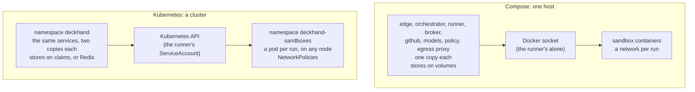

# Deckhand on Kubernetes

`deploy/kubernetes/` runs Deckhand on a cluster: a kustomize base with every service, the
sandboxes in a namespace of their own, and optional components: `redis` (the stores, for
copies on several nodes), `blobs` (blob storage for the logs and screenshots), `buildkit`
(repositories' own images) and `engine` (a container engine for runs). `deploy/helm/deckhand/` is
the same as a Helm chart, with values instead of patches, published with each release after 0.2.0
as `oci://ghcr.io/bryansmee/charts/deckhand`. Each run's sandbox is a pod
(`RUNNER=kubernetes`): runs spread over the cluster's nodes, and `MAX_PARALLEL` still caps how
many run at once. [The guides](guides/install.md) have the rest (the GitHub App's permissions,
the settings, the agents): these pages are what differs on a cluster.

- **Install**, after the [requirements](#requirements) below: [with Helm](kubernetes/helm.md) or
  [with kustomize](kubernetes/install.md), then [finish the install](kubernetes/finish.md) (the
  Secrets, the GitHub App, the isolation's check).
- [Updating](kubernetes/updating.md): every service, without stopping the runs.
- [Components](kubernetes/components.md): Redis for several nodes, blob storage, BuildKit for
  repositories' images, a container engine for runs.
- [Sandboxes on a cluster](kubernetes/sandboxes.md): the namespaces, the agents' and caches'
  claims.
- [Isolation](kubernetes/isolation.md): what the manifests set up and why, and the checks the
  runner makes before every run.
- [Metrics](kubernetes/metrics.md): the scrape port, its NetworkPolicy, the chart's
  ServiceMonitor, dashboard and alerts.

The same services either way; what changes is who starts the sandboxes and where the state
lives:



| Service      | Copies                           | Readiness | Grace (s) | Volumes                                            | Secrets                                                              |
| ------------ | -------------------------------- | --------- | --------- | -------------------------------------------------- | -------------------------------------------------------------------- |
| edge         | 2, both active                   | `/ready`  | 40        | `edge-data` (its store)                            | `deckhand-edge`                                                      |
| orchestrator | 2, active/passive                | `/health` | 300       | `orchestrator-data` (its store; none with `redis`) | none                                                                 |
| runner       | 2, active/passive                | `/health` | 300       | `runner-data` (its store, the runs' inboxes)       | none (its ServiceAccount's API token); `deckhand-blobs` with `blobs` |
| broker       | 2, both active                   | `/ready`  | 45        | `broker-store`                                     | `deckhand-broker-key`; `deckhand-blobs` with `blobs`                 |
| github       | 2, both active                   | `/ready`  | 300       | `github-data` (its store, the git mirrors)         | `deckhand-github`                                                    |
| models       | 2, both active                   | `/ready`  | 630       | `models-store`                                     | `deckhand-models`, `-models-key`, `-credentials`                     |
| policy       | 2, both active                   | `/ready`  | 40        | none                                               | none                                                                 |
| egress proxy | 1, and a second during an update | `/ready`  | 630       | `egress-cache` (its cache, its CA)                 | none                                                                 |

## Requirements

- **Kubernetes 1.30 or later**, and `kubectl` (its `-k` is kustomize), or Helm 3 or 4 for the
  chart.
- **A network plugin that enforces NetworkPolicies**: Calico, Cilium, or k3s's own (kube-router).
  One that ignores them (Flannel alone, say) takes them and isolates nothing: a sandbox could then
  call the services directly, the orchestrator's run tokens among them. The runner checks it itself
  and refuses every run on a cluster that doesn't
  ([The network probe](kubernetes/isolation.md#the-network-probe)); `check-isolation.sh` checks it
  by hand ([Checking the isolation](kubernetes/finish.md#checking-the-isolation)).
- **A default storage class** for the services' claims (`ReadWriteOnce`), and for the issues'
  session claims (`KUBERNETES_STORAGE_CLASS`). On several nodes, one with `ReadWriteMany` too
  ([Several nodes](kubernetes/components.md#several-nodes)). A sandbox mounts a folder of each
  session claim (`.deckhand-session`), not its root, which a block volume's filesystem fills with
  `lost+found`. Claims made before Deckhand did so (without the annotation
  `deckhand.layout: folder`) are still mounted at their root, where their clone and session are. On
  such a class, delete those whose issue's runs fail on `lost+found` (git's clone:
  `already exists and is not an empty directory`, #643), the issue's `-workspace` claim and its
  agent's: its next run makes them again. Optional: a `ReadWriteMany` class for the agents' and
  caches' claims ([Agents](kubernetes/sandboxes.md#agents-on-kubernetes),
  [Caches](kubernetes/sandboxes.md#caches-on-kubernetes)).
- **The kubelet**: a `containerLogMaxSize` above `RUN_LOG_MAX_MB` (the default 10 MiB rotates a
  run's log away, and a runner restarted mid-run then misses or repeats lines: it logs a
  warning), and a `podPidsLimit`, as Kubernetes only limits processes per node (grants'
  `limits.pids` don't apply).
- **An ingress** (or a load balancer) that sends `https://<your host>/` to the `edge` Service's
  port 8080, with TLS: GitHub's webhooks and the dashboard come in there. Edge is the only
  service it may reach.
- **Node 26 on your machine**, for `deploy/kubernetes/secrets.mjs` (the keys and the GitHub App),
  from a checkout of this repository.

## The API server's addresses

The runner (the sandboxes' pods) and the broker (its callers' TokenReviews) reach the API server and
nothing else, through the `deckhand-api-server` NetworkPolicy. Its address in the base is a
placeholder that reaches nothing, so both fail until you name yours, one `ipBlock` each: a patch of
your overlay's ([Install with kustomize](kubernetes/install.md#2-the-api-servers-addresses)), or the
chart's `apiServer.cidrs` ([Install with Helm](kubernetes/helm.md#1-your-values)). Find them with:

```sh
kubectl get endpointslices -n default -l kubernetes.io/service-name=kubernetes \
  -o jsonpath='{range .items[*].endpoints[*]}{.addresses[0]}{"\n"}{end}'
```

They are the addresses NetworkPolicies see: a call to the `kubernetes` Service's IP is
translated to them first (on 443 or 6443, both let through). Set them again if your control
plane's addresses change. On Cilium, which matches the API server by identity rather than
address, add a `CiliumNetworkPolicy` with `toEntities: [kube-apiserver]` for the runner's and the
broker's pods instead.

## Not supported yet

- **Host mounts** (`mounts`): a run of a repository with some is refused, with a reply naming
  the runner.
- **A repository's own image** (`dockerfile`) without `KUBERNETES_REGISTRY`
  ([Repo images](kubernetes/components.md#repo-images)).

A container engine (`docker`) runs through Sysbox's RuntimeClass:
[Container engine on Kubernetes](kubernetes/components.md#container-engine-on-kubernetes), which
also says when a run that would get one is still refused.
