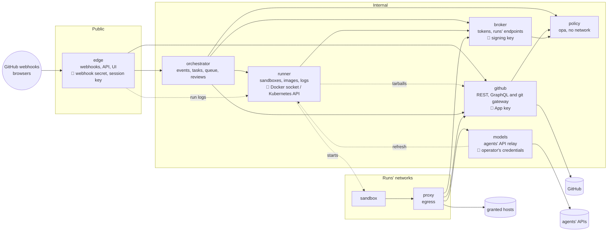

# Services (target)

Where the listener is headed once it is split (#499, its parts #500 to #509). Today it is still one
process, beside the egress proxy: [architecture.md](architecture.md) describes what runs now.

The split follows who holds which secret and who can reach what. The only service the internet
reaches holds neither the App's key, the operator's agent credentials nor the Docker socket, and
each secret lives in one service.

| Service      | Holds                                     | Owns (its own store)                    | Reached by                                                                                                              |
| ------------ | ----------------------------------------- | --------------------------------------- | ----------------------------------------------------------------------------------------------------------------------- |
| edge         | webhook secret, session key, OAuth client | sessions                                | the internet, browsers                                                                                                  |
| orchestrator | nothing secret                            | queue, waits, tasks, history, decisions | edge                                                                                                                    |
| runner       | Docker socket or Kubernetes API           | containers, networks, run logs          | orchestrator, models (the plan logins' refresh only), edge (the run's log, for the dashboard)                           |
| broker       | the tokens' signing key                   | live runs, run files                    | orchestrator, runner (a run's first token), proxy (sandboxes), every service that calls another (its own service token) |
| github       | the App's key, installation tokens        | each run's issues, reactions, pushes    | edge, orchestrator, proxy, runner (the repo's tarball, for build contexts and previews)                                 |
| models       | the operator's agent credentials          | plan logins                             | proxy                                                                                                                   |
| policy       | nothing secret                            | nothing (reads the policy folders)      | github, orchestrator, broker                                                                                            |
| proxy        | Deckhand's CA                             | the egress cache                        | sandboxes                                                                                                               |

The broker also serves the endpoints a sandbox calls about its own run: progress, needs-input, its
files. Every service that calls another also calls it for its own service token (#500), which the
diagram leaves out; the policy service calls none, and checks the tokens it gets offline. The dotted
arrows are narrow: the runner fetches a repository's tarball from the github service for build
contexts and preview hooks (the App's key stays there), edge reads a run's log from the runner for
the dashboard's live view, and models has the runner start the plan logins' refresh.

## Upgrades without downtime

A run calls the proxy, the broker, the github, models and policy services while it runs, never
the orchestrator or the runner: sandboxes run detached, and their events wait in the store's
streams until the orchestrator acknowledges them.

| Service                      | Copies                           | On an update                                                                                                                                                       |
| ---------------------------- | -------------------------------- | ------------------------------------------------------------------------------------------------------------------------------------------------------------------ |
| policy                       | 2, active                        | no state: the new copy starts, the old one drains                                                                                                                  |
| github, models, broker, edge | 2, active                        | shared state in the store; the new copy starts, the old one drains (models: up to 10 minutes, an agent call's length)                                              |
| orchestrator, runner         | 2, active/passive                | the old copy releases its lease on SIGTERM, the new one takes it at once and restores from the store: about a second                                               |
| proxy                        | 1, and a second during an update | both on every run's network under the same name; the new copy takes new connections, the old one drains up to 10 minutes, an agent call's length, as models (#500) |

Every agent call goes through the proxy to the models service, so the proxy's drain has to last as
long as the models service's. A single proxy can't: the next one only starts once it exits, and the
agents' CLIs, git and `gh` don't try a refused connection again (only `deckhand-files` and
`deckhand-inbox` do), so a long drain would refuse every sandbox's new connections that long. A
second copy during an update removes that limit (#500): it takes the new connections while the old
one drains, as long as an agent call lasts. On Kubernetes, that's a Deployment's rolling update (one
replica, `maxSurge: 1`, `maxUnavailable: 0`).

**On Docker Compose**, every service runs as one copy (the test server): Compose stops a container
before it starts the next, so an update is a wait rather than a handover. The proxy waits 5 minutes
for a service that refuses its connection (#507), enough for a service's drain and the next one's
start, but not for the models service's 10 minutes: a new agent call made more than 5 minutes before
its drain ends gives up before the next copy starts, and fails; those made in its last 5 minutes
wait and go through. A proxy update drains for 25 s only (#507), then cuts the agent calls still
going. Until the split, the proxy waits for a restarting listener instead of failing, for every call
a sandbox makes to it (#511). Two copies on Kubernetes have none of these gaps.

Active/passive is safe because state is saved as it changes (#508), each lease holder gets a
higher fencing epoch that the github service, the runner and the broker check, events are
acknowledged once handled, and side effects carry idempotency keys (#506). The store is the
file backend on one node, Redis on several (#509).

## What limits a leaked token

- **Run tokens** (#493): **where**, the services are reachable from the runs' networks only
  through the proxy, so a token leaked to the internet opens nothing; **who**, it is bound to
  its sandbox's network, which the proxy vouches for, so another sandbox can't replay it; **how
  long**, 15 minutes at most, and nothing once its network is removed. The agent's own token,
  which its CLI reads once at start and can't renew, lasts the run instead (7 days at most), bound
  the same way and for the agents' endpoints alone (security.md, Run tokens).
- **Service tokens** (#500): signed by the broker, with `sub` (the caller) and `aud` (the
  service called), short-lived, and bound to the caller: its pod's service account on
  Kubernetes, the network a call arrives on with Docker (one network per caller and callee).
- **What each caller may do**: each service accepts from each caller only what it needs, in
  one table per service. The github service lets edge read, never mint a token or write: a
  compromised edge, already inside the internal network, gets no more.
- **The network has to be closed**: with Docker, only the proxy sits on the runs' networks (a
  test reads `compose.yaml`); on Kubernetes, NetworkPolicies need a network plugin that enforces
  them (#396).

## Rules

- **No shared database**: each service keeps its own state through one store interface (#500), and
  passes its changes to those that need them as store streams, acknowledged once handled, so a
  handover loses none. The broker streams run starts, ends and progress; edge, verified events; the
  orchestrator, task updates for the dashboard; the runner, run events (started, ended, exit code;
  logs go to the store's blobs); models, the plans' usage for edge.
- **Secrets never go in the store** but encrypted by their own service, with a key only it
  holds: the plan logins the models service refreshes, for example (#504). The App's key, the
  signing key and the agents' credentials stay in their service's own secret or volume, never in
  the store (#509). With Redis on several nodes, every service that uses the store could read
  them otherwise.
- **Shared code** in `lib/`, copied into each image: no npm package in it, so "no runtime
  dependencies" holds per service. The github service keeps the listener's one exception,
  graphql-js, bundled at build (`listener/vendor/`).
- **Sandboxes outlive an update**: an endpoint that moves to another service first answers, for a
  while, with where to go instead (`docs/architecture.md`, Restarts).
- **The security rules of `AGENTS.md` hold per service.**
- **The UI** stays in edge: static files from the dashboard's build, on the same origin as its
  API.
