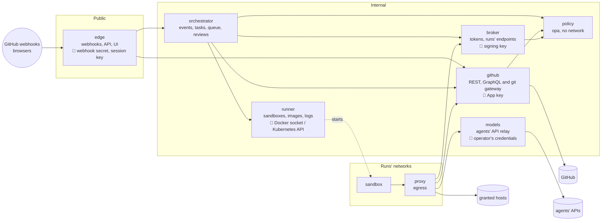

# Services (target)

Where the listener is headed once it is split (#499, its parts #500 to #506). Today it is still one
process, beside the egress proxy: [architecture.md](architecture.md) describes what runs now.

The split follows who holds which secret and who can reach what. The only service the internet
reaches holds neither the App's key nor the Docker socket, and each secret lives in one service.

| Service      | Holds                                     | Owns (its own store)                    | Reached by                   |
| ------------ | ----------------------------------------- | --------------------------------------- | ---------------------------- |
| edge         | webhook secret, session key, OAuth client | sessions                                | the internet, browsers       |
| orchestrator | nothing secret                            | queue, waits, tasks, history, decisions | edge                         |
| runner       | Docker socket or Kubernetes API           | containers, networks, run logs          | orchestrator                 |
| broker       | the tokens' signing key                   | live runs, run files                    | orchestrator, runner, proxy  |
| github       | the App's key, installation tokens        | each run's issues, reactions, pushes    | edge, orchestrator, proxy    |
| models       | the operator's agent credentials          | plan logins                             | proxy                        |
| policy       | nothing secret                            | nothing (reads the policy folders)      | github, orchestrator, broker |
| proxy        | Deckhand's CA                             | the egress cache                        | sandboxes                    |

The broker also serves the endpoints a sandbox calls about its own run: progress, needs-input,
its files.

## What limits a leaked token

- **Run tokens** (#493): **where**, the services are reachable from the runs' networks only
  through the proxy, so a token leaked to the internet opens nothing; **who**, it is bound to
  its sandbox's network, which the proxy vouches for, so another sandbox can't replay it; **how
  long**, 15 minutes at most, and nothing once its network is removed.
- **Service tokens** (#500): signed by the broker, with `sub` (the caller) and `aud` (the
  service called), short-lived, and bound to the caller: its pod's service account on
  Kubernetes, the network a call arrives on with Docker (one network per caller and callee).
- **What each caller may do**: each service accepts from each caller only what it needs, in
  one table per service. The github service lets edge read, never mint a token or write: a
  compromised edge, already inside the internal network, gets no more.
- **The network has to be closed**: with Docker, only the proxy sits on the runs' networks (a
  test reads `compose.yaml`); on Kubernetes, NetworkPolicies need a network plugin that enforces
  them (#396).

## Rules

- **No shared database**: each service keeps its own state, and streams its changes to those
  that need them (server-sent events). The broker streams run starts, ends and progress; the
  orchestrator streams task updates to edge; the runner streams run logs.
- **Shared code** in `lib/`, copied into each image: no runtime dependencies, per service.
- **The UI** stays in edge: static files from the dashboard's build, on the same origin as its
  API.
