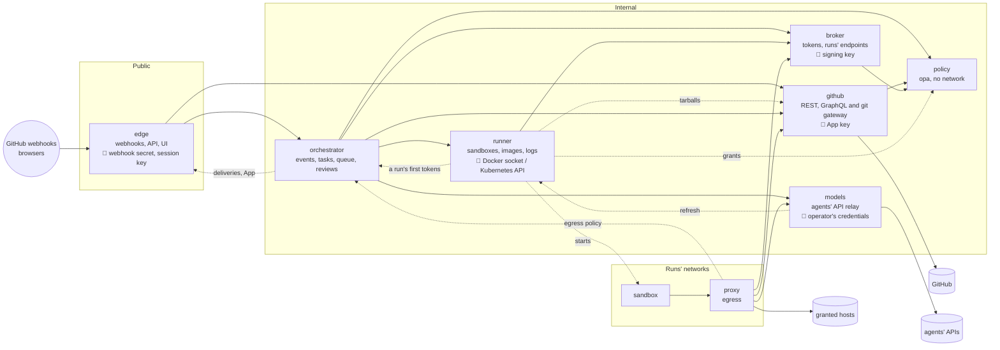

# Services

Deckhand runs as services (#499, its parts #500 to #509): edge and the orchestrator (#506,
[Edge and the orchestrator](#edge-and-the-orchestrator)), beside the policy
service (#501, [architecture.md](architecture.md#the-policy-service)), the broker (#505,
[architecture.md](architecture.md#the-broker-service)), the
runner (#503, [architecture.md](architecture.md#the-runner-service)), the github service (#502,
[architecture.md](architecture.md#the-github-service)), the models service (#504,
[architecture.md](architecture.md#the-models-service)) and the egress proxy, each from its own image:
[architecture.md](architecture.md) describes what each module does.

The split follows who holds which secret and who can reach what. The only service the internet
reaches holds neither the App's key, the operator's agent credentials nor the Docker socket, and
each secret lives in one service.

| Service      | Holds                                     | Owns (its own store)                               | Reached by                                                                                                                                                             |
| ------------ | ----------------------------------------- | -------------------------------------------------- | ---------------------------------------------------------------------------------------------------------------------------------------------------------------------- |
| edge         | webhook secret, session key, OAuth client | sessions, deliveries taken, their stream           | the internet, browsers, orchestrator (the deliveries' stream, the App's public parts, the dashboard's tags)                                                            |
| orchestrator | nothing secret                            | queue, waits, tasks, history, decisions, its lease | edge (the dashboard's API), runner (a run's first tokens, once its sandbox's network exists), proxy (the egress policy)                                                |
| runner       | Docker socket or Kubernetes API           | containers, networks, run logs                     | orchestrator (and the egress policy, which stays with it), models (the plan logins' refresh only)                                                                      |
| broker       | the tokens' signing key                   | live runs, run files                               | orchestrator (a run's first tokens, for the runner), runner (the runs' inboxes and files), proxy (sandboxes), every service that calls another (its own service token) |
| github       | the App's key, installation tokens        | each run's issues, reactions, pushes               | edge, orchestrator, proxy, runner (the repo's tarball, for build contexts)                                                                                             |
| models       | the operator's agent credentials          | plan logins (sealed), runs' API state              | proxy (the agents' calls), orchestrator (which credentials it holds, their fingerprints, a run's API state, its stream)                                                |
| policy       | nothing secret                            | nothing (reads the policy folders)                 | github, orchestrator, broker, runner (the operator's grants for a repository)                                                                                          |
| proxy        | Deckhand's CA                             | the egress cache                                   | sandboxes                                                                                                                                                              |

The broker also serves the endpoints a sandbox calls about its own run: its token's renewal, its
inbox and files (`broker/`, #505). A run's progress and its questions still come from its
log, which the runner follows: nothing for a sandbox to call yet. The egress policy is
the orchestrator's: it answers by the address a connection comes from, which it
asks the runner, and gives the proxy the network it vouches for to the broker. A run's first
tokens are the orchestrator's to have the broker sign, with the claims it decided: the runner asks
it for them once the sandbox's network (or pod) exists, and never chooses what they allow. Every service that calls another also calls it for its own service token (#500), which the
diagram leaves out; the policy service calls none, and checks the tokens it gets offline. The dotted
arrows are narrow: the runner fetches a repository's tarball from the github service for build
contexts (the App's key stays there), models has the runner start the plan logins' refresh, and the runner copies each run's inbox and
files to the broker as they change (`listener/runner/inbox.mjs` `mirror`), and the runner asks the
policy service what the operator's policies [grant](security.md#the-grants) a repository
(`GET /policies`, `POST /evaluate`, the operator's layer only), to check every sandbox spec
and image build against it again. A run's live log reaches the dashboard through
the orchestrator, which reads it from the runner and answers what edge passes on: edge calls the
runner for nothing.

## Upgrades without downtime

A run calls the proxy, the broker, the github, models and policy services while it runs, never
the orchestrator or the runner: sandboxes run detached, and their events wait in the store's
streams until the orchestrator acknowledges them.

| Service                      | Copies                           | On an update                                                                                                                                                       |
| ---------------------------- | -------------------------------- | ------------------------------------------------------------------------------------------------------------------------------------------------------------------ |
| policy                       | 2, active                        | no state: the new copy starts, the old one drains                                                                                                                  |
| github, models, broker, edge | 2, active                        | shared state in the store; the new copy starts, the old one drains (models: up to 10 minutes, an agent call's length)                                              |
| orchestrator, runner         | 2, active/passive                | the old copy releases its lease on SIGTERM, the new one takes it at once and restores from the store: about a second                                               |
| proxy                        | 1, and a second during an update | both on every run's network under the same name; the new copy takes new connections, the old one drains up to 10 minutes, an agent call's length, as models (#500) |

Every agent call goes through the proxy to the models service, so the proxy's drain has to last as
long as the models service's. A single proxy can't: the next one only starts once it exits, and the
agents' CLIs, git and `gh` don't try a refused connection again (only `deckhand-files` and
`deckhand-inbox` do), so a long drain would refuse every sandbox's new connections that long. A
second copy during an update removes that limit (#500): it takes the new connections while the old
one drains, as long as an agent call lasts. On Kubernetes, that's a Deployment's rolling update (one
replica, `maxSurge: 1`, `maxUnavailable: 0`).

**On Docker Compose**, every service runs as one copy (the test server): Compose stops a container
before it starts the next, so an update is a wait rather than a handover. The proxy waits 5 minutes
for a service that refuses its connection (#507), enough for a service's drain and the next one's
start, but not for the models service's 10 minutes: a new agent call made more than 5 minutes before
its drain ends gives up before the next copy starts, and fails; those made in its last 5 minutes
wait and go through. A proxy update drains for 25 s only (#507), then cuts the agent calls still
going. The proxy waits for a restarting orchestrator instead of failing, for every call a sandbox
makes to it (#511). Two copies on Kubernetes have none of these gaps, and nor do two copies of
the orchestrator on one node ([below](#edge-and-the-orchestrator)).

Active/passive is safe because state is saved as it changes (#508), each lease holder gets a
higher fencing epoch that the github service, the runner and the broker check, events are
acknowledged once handled, and side effects carry idempotency keys (#506). The store is the
file backend on one node, Redis on several (#509).

### Draining

Every service is to drain the same way on SIGTERM (`lib/drain.mjs` `drainOnSigterm()`): it stops
accepting connections, finishes those in flight within its grace period, then exits. The proxy,
the policy service, the broker (30 s, over an inbox's long poll), the github service (280 s:
pushes, clones) and the models service (10 minutes, an agent call's length) use it so far (their
`/ready` answers 503 from then on, for a readiness probe); the runner
drains its own way (its output streams first, then its lease, `runner/service.mjs` `stop()`), and
so do edge (its two ports, then the poller's lease, `edge/server.mjs`) and the orchestrator (its
state saved and its lease released, then its broker port and the egress policy,
`orchestrator/server.mjs`). With two
copies and a rolling update that starts the new copy first, an upgrade fails no call: the new
copy takes the connections the old one no longer accepts.

### Edge and the orchestrator

Two services (#506): the part the internet reaches, and the queue and the runs' logic.

**Edge** (`edge/`) takes GitHub's webhooks (their HMAC checked), `/setup`, sign-in and sessions,
and serves the dashboard's files. It holds the webhook secret, the session key and the OAuth
client's, in its own volume, nothing else. Its two copies are both active, on one store:

- a delivery's GUID is set-if-absent there (kept a day: a redelivery of one taken, by hand, comes
  within it), so one
  GitHub sends twice, or that reaches both copies, goes on once;
- a verified delivery goes on the `deliveries` stream before it is answered (202); the store
  away, it is refused (503) and its GUID freed, for GitHub's redelivery;
- the sessions' epochs: a sign-out ends the login's sessions on both copies;
- the redeliveries' poller runs on the copy holding its lease (`edge/redeliveries`), and the
  other takes it once that one stops.

The dashboard's API, `/status` and the screenshots, edge passes on to the orchestrator
(`edge/forward.mjs`), with the signed-in user, its service token, and the browser's Host and
Origin; the answer comes back as it streams (a run's live log, which ends once its user signs
out). The API's contract (`dashboard/src/types.ts`) and the UI's origin don't change: the CSP
and the `SameSite` cookies are as before. Edge's internal port is the orchestrator's alone: the
stream, read and acknowledged; the App's public parts; the dashboard's "From the dashboard by"
tags, signed with the key the webhook secret gives (the orchestrator posts those lines, and
holds no key); a redeliveries' scan, for the dashboard's Sync.

**The orchestrator** (`orchestrator/server.mjs`) owns the rest: intake (deliveries to tasks,
`/mode`, `/after`, the dashboard's actions), the tasks and the queue, a run's life, what it
starts by itself (reviews, fixes, CI fixes, auto-merge, reviewers, conflicts, onboarding), what the dashboard shows, restarts. It holds no secret and has no way out.
Its two copies are active/passive:

1. **One acts**, the one holding the `orchestrator` lease in its store (`lib/active.mjs`, 15 s,
   `LEASE_SECONDS`, renewed every third of it): it consumes the streams (edge's deliveries, the
   broker's, the runner's, the github and models services'), arms the timers, starts runs. The
   other opens its services port for its probes (`/health`; `/ready` answers 503), answers 503
   to every call, and waits for the lease.
2. **A handover on an update**: the new copy starts and waits; the old one, on SIGTERM, refuses
   edge's and the runner's calls (503: they ask again), stops reading the streams (the deliveries
   being handled are acknowledged first), saves what it holds (already in the store, #508), and
   **releases the lease**; the new one takes it at once, rebuilds its tasks from the store,
   re-arms the deadlines and reads the streams from their last acknowledged event. About a
   second: no event is lost, no call fails, a reply or a run starts a second later at most. The
   old copy then drains its broker port for the sandboxes' calls in flight.
3. **On a crash** the lease expires (15 s) and the waiting copy takes it the same way. A copy
   that loses its lease while acting exits: its restart makes it the waiting one.
4. **Fencing**: each new holder gets a higher epoch (at least the time in ms), sent with every
   call to the github service, the runner and the broker, which refuse one older than the newest
   they have seen (409, `lib/fence.mjs`): a copy that lost its lease without noticing (a long
   pause, a network cut) can't post a reply, start or stop a run, nor have a run's tokens
   signed or ended.
5. **Side effects safe to replay**: a delivery handled but not yet acknowledged when a copy
   stops is handled again by the next, unless it was (`deliveries/handled/<guid>` in the store).
   A reply carries a key by its run and kind (`<run>:reply`), a run's start its run's id, which
   the github service (#502) and the runner (#503) remember: nothing is done twice.

On one node, the store's file backend is shared by the processes using its folder
(`lib/store-file.mjs`: a lock file, and `state.json` read again once another process wrote it),
so two copies of the orchestrator on one volume work with Compose too (`docker compose up -d
--scale orchestrator=2`); Redis, on several nodes. Both copies are on the proxy's network
under the name `listener`, and Docker's DNS answers it with either: the waiting
copy refuses those connections, and the proxy tries them again until the acting one takes them
(Kubernetes keeps the waiting copy out of its Service by `/ready` instead). With one copy
(Compose's default), an update is a stop, then a start: the next copy takes the lease at once, as
the old one released it.

### The models service

The only service with the operator's agent credentials (#504, `models/`): the agents' API
endpoints (`models/upstream.mjs`, `anthropic.mjs`, `openai.mjs`, `google.mjs`) and the plans'
logins (`chatgpt.mjs`, `antigravity-login.mjs`). The egress proxy sends the sandboxes' agent
calls there, with their agent token and the network it vouches they came from; the service
checks the token offline with the broker's keys, its `agent` claim (a run of one agent never
gets another's credentials) and that the run still goes, at the broker. The orchestrator learns
which credentials it holds by name, at start (its settings need them), and their fingerprints,
for redaction (security.md, The models service).

**Two copies, both active**, on one store: either takes any call. The plans' refresh tokens are
single-use, so a refresh is a lease in the store: one copy refreshes, the other waits for its
result, which is kept sealed with a key only the service holds (`models/logins.mjs`). A run's
API state (its provider's last status, a plan's reset, its last failure) is in the store too,
by the run's id, for the orchestrator's reply and fallbacks at the run's end (`GET
/runs/:id/api`); the calls refused a run go on the `models` stream, a line each in its log. A
run has 16 calls in flight at most per copy.

**A rolling update with a long drain**: an agent call streams for up to 10 minutes, so a copy
that stops refuses new calls (`/ready` 503, no new connection) and lets those in flight finish
within 10 minutes (`DRAIN_SECONDS=600`): no turn is cut (`test/models.test.mjs`). On Kubernetes,
a Deployment with two replicas, `maxUnavailable: 0`, a readiness probe on `/ready` and
`terminationGracePeriodSeconds` of 630. With Docker Compose, one copy (above).

**Sandboxes outlive the update**: their agents keep the base URL they started with (the
broker's host), which the proxy sends on to the models service.

### The policy service

The policy decisions' service (#501): long-lived `opa` servers behind a small HTTP service
(`policy-service/`), with no network but its callers', no secret and no state. Its callers send
a repository's policy files with each decision (it can't read GitHub); it reads the operator's
from the grants folder, mounted read-only. With Docker Compose, the orchestrator and the runner each
reach it on an internal network of their own (`policy`, `policy-runner`); the runner may only ask
decisions (`GET /policies`, `POST /evaluate`: the operator's grants), never `/capabilities` or
`/check`. Any copy answers any decision the same way, so two copies
on Kubernetes are a Deployment with a readiness probe on `/ready` and `maxUnavailable: 0`: the new
copy starts, the old one drains (25 s) with its decisions in flight
(`test/policy-service.test.mjs`). With Docker Compose it is one copy, and the orchestrator waits up
to 30 s for a restarting one rather than refusing its decisions.

### The proxy's handover

The proxy runs as **one copy, and a second during an update**: no permanent second copy is
needed.

1. The new copy starts and joins every run's network under the same name (`egress`). It takes
   the new connections once ready: it answers `GET /ready` (plain HTTP, the readiness probe's).
2. The old one, out of rotation, takes no new connection and drains for as long as an agent
   call lasts (`DRAIN_SECONDS=600`): an agent's stream through it goes on to its end, then the
   old copy exits (`test/proxy-handover.test.mjs`).

On Kubernetes, that's a Deployment with one replica, `strategy: RollingUpdate`, `maxSurge: 1`,
`maxUnavailable: 0`, a readiness probe on `/ready`, and `terminationGracePeriodSeconds` covering
the drain (630 for a 600 s drain, #396).

With Docker Compose, which stops a container before it starts the next, nothing changes: the
proxy drains for 25 s (`DRAIN_SECONDS`' default, under its `stop_grace_period` of 30 s), and the
gap stays (above). The Compose test server keeps it.

## What limits a leaked token

- **Run tokens** (#493): **where**, the services are reachable from the runs' networks only
  through the proxy, so a token leaked to the internet opens nothing; **who**, it is bound to
  its sandbox's network, which the proxy vouches for, so another sandbox can't replay it; **how
  long**, valid for 15 minutes, then renewable only from its own sandbox, by the one the
  sandbox holds, within a 7-day grace (`RENEW_GRACE_MS`, so a broker away for a while doesn't
  end the run), and nothing once its network is removed. The agent's own token,
  which its CLI reads once at start and can't renew, lasts the run instead (7 days at most), bound
  the same way and for the agents' endpoints alone (security.md, Run tokens).
- **Service tokens** (#500, security.md, Service tokens): signed by the broker, with `sub` (the
  caller) and `aud` (the service called), 15 minutes, and bound to the caller: its pod's service
  account on Kubernetes, the network a call arrives on with Docker (one network per caller and
  callee).
- **What each caller may do**: each service accepts from each caller only what it needs, in
  one table per service. The github service lets edge read, never mint a token or write: a
  compromised edge, already inside the internal network, gets no more.
- **The network has to be closed**: with Docker, only the proxy sits on the runs' networks (a
  test reads `compose.yaml`); on Kubernetes, NetworkPolicies need a network plugin that enforces
  them (#396).

## Rules

- **No shared database**: each service keeps its own state through one store interface
  (`lib/store.mjs`: keys with TTLs, atomic operations, leases with a fencing epoch, acknowledged
  streams, blobs; its file backend for one node, `lib/store-file.mjs`, #500; Redis on several,
  `lib/store-redis.mjs`, #509: [setup.md](setup.md#the-store)), and
  passes its changes to those that need them as store streams, acknowledged once handled, so a
  handover loses none. The broker streams run starts, ends and progress; edge, verified events; the
  orchestrator, task updates for the dashboard; the runner, run events (started, ended, exit code;
  logs go to the store's blobs); models, the agents' calls it refused each run, for its log.
- **Secrets never go in the store** but encrypted by their own service, with a key only it
  holds: the plan logins the models service refreshes, for example (#504). The App's key, the
  signing key and the agents' credentials stay in their service's own secret or volume, never in
  the store (#509). With Redis on several nodes, every service that uses the store could read
  them otherwise.
- **Shared code** in `lib/`, copied into each image: no npm package in it, so "no runtime
  dependencies" holds per service. The github service keeps Deckhand's one exception,
  graphql-js, bundled at build (`listener/vendor/`).
- **Sandboxes outlive an update**: an endpoint that moves to another service first answers, for a
  while, with where to go instead (`docs/architecture.md`, Restarts).
- **The security rules of `AGENTS.md` hold per service.**
- **The UI** stays in edge: static files from the dashboard's build, on the same origin as its
  API.
